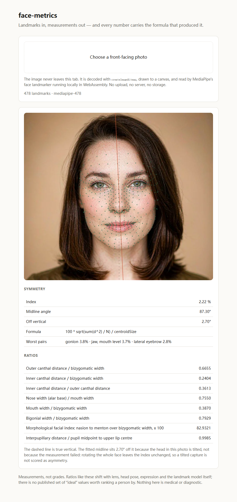

# face-metrics

Facial geometry from landmark sets — a mirror-symmetry index and anthropometric ratios — where **every number carries the formula that produced it**.

Zero dependencies. Plain ES modules. Runs in Node 18+ and in the browser with no build step.



```
$ node bin/face-metrics.mjs landmarks.json

schema: mediapipe-478 (MediaPipe Face Mesh with iris refinement, 478 points)

symmetry
  index                1.27   percent of centroid size
  midline angle        89.92   degrees from +x
  centroid size        0.2451
  formula              100 * sqrt(sum(d^2) / N) / centroidSize

  worst pairs
    mouth corner         0.01051  (4.29%)
    jaw, mouth level     0.00176  (0.72%)
    gonion               0.00156  (0.64%)

ratios
  interocular-outer  0.5263   |p33 - p263| / |p234 - p454|
  interocular-inner  0.2632   |p133 - p362| / |p234 - p454|
  eye-spacing        0.5000   |p133 - p362| / |p33 - p263|
  nose-mouth         0.6977   |p129 - p358| / |p61 - p291|
  mouth-face         0.2263   |p61 - p291| / |p234 - p454|
  jaw-cheek          0.7895   |p172 - p397| / |p234 - p454|
  face-index         63.1579   100 * |p168 - p152| / |p234 - p454|
  midface            1.3333   |p468 - p473| / |mid(p468, p473) - p0|
```

## What it does

- **Does not detect faces.** You bring the landmarks (MediaPipe Face Mesh, dlib/iBUG 68, or any array you can index).
- Fits the facial midline to paired landmarks and reports how far the two sides are from being mirror images, invariant to position, scale and in-plane rotation.
- Reports a small set of anthropometric ratios, each with the landmark indices it read.
- Aligns two configurations with a least-squares similarity transform (the Procrustes step) so they can be compared after removing pose.
- Returns **`null` plus a reason** for any ratio the markup cannot support, instead of approximating it from the wrong point.

## What it does not do

It does not return a beauty score. A single number with no published formula is not a measurement, and the published evidence for any particular set of "ideal" proportions is much weaker than the internet implies — see [Limitations](#limitations).

## Install

Not on npm. Either vendor the source or install from git:

```bash
npm install github:Robin2027/face-metrics
```

Or just copy `src/` (six small files, no imports outside each other) into your project and import the file directly.

## Quick start

```js
import { metrics } from 'face-metrics';

// 468 or 478 points from MediaPipe, or 68 from dlib.
// Pixel coordinates and normalised 0-1 coordinates both work: every measure is
// a ratio, and the symmetry index is divided by centroid size.
const report = metrics(landmarks);

report.symmetry.index;              // 1.27  (percent of centroid size)
report.symmetry.axis.angleDegrees;  // 89.92 (fitted midline)
report.symmetry.pairs;              // per-pair residuals, worst first
report.ratios.measured;             // [{ key, value, formula, landmarks }]
report.ratios.unavailable;          // [{ key, reason }]
```

In the browser, the same call, no bundler:

```html
<script type="module">
  import { metrics } from './src/index.mjs';
  const report = metrics(points);
</script>
```

A complete browser demo that runs MediaPipe on a local photo, draws the landmarks and the fitted midline (against a dashed true vertical, so a tilted capture is visible as a tilt rather than as a crooked drawing), and prints the table is in [`examples/browser/index.html`](examples/browser/index.html). The photo never leaves the tab. The 3.6 MB face landmarker model is bundled in [`models/`](models/) and served either from jsDelivr or from that path — never from Google's storage, which is unreachable on some networks.

```bash
node examples/node-quickstart.mjs    # 20 lines, no dependencies
npm test                             # 20 tests, no test framework
```

## CLI

```bash
node bin/face-metrics.mjs landmarks.json
node bin/face-metrics.mjs landmarks.json --json
node bin/face-metrics.mjs landmarks.json --schema dlib68
```

Accepted JSON: a bare array of points, `{ "points": [...] }`, or the raw output of MediaPipe's JavaScript face landmarker (`{ "faceLandmarks": [[...]] }`).

## The symmetry index

For every anatomical pair — left canthus and right canthus, left mouth corner and right mouth corner — the library looks for the single straight line that best maps one side onto the other by reflection. That line is the facial midline implied by the landmarks themselves, so no midline point has to be nominated by hand, and a face that is tilted in the photo does not read as asymmetric.

A reflection through the origin about an axis at angle *t* is `Q(t) = [[cos 2t, sin 2t], [sin 2t, −cos 2t]]`. Minimising `Σ |rᵢ − Q lᵢ|²` is the same as maximising `cos(2t)·A + sin(2t)·B`, with `A = Σ(rx·lx − ry·ly)` and `B = Σ(rx·ly + ry·lx)`, so `2t = atan2(B, A)`. Closed form, no iteration and no SVD.

The reported index is

```
100 × sqrt( Σ dᵢ² / N ) / centroidSize
```

where `dᵢ` is the distance from each right landmark to the reflection of its left counterpart across the fitted axis, `N` is the number of pairs, and `centroidSize` is the RMS distance of all 2N landmarks from their centroid.

Three properties follow, and the test suite pins all three:

| Property | Test |
|---|---|
| An exactly mirrored configuration measures 0 | `a mirrored configuration has zero asymmetry` |
| Rotation, scale and translation do not change the index | `index is invariant to position, scale and rotation` |
| The recovered axis is the axis the pairs were mirrored about | `the fitted axis is the axis the pairs were mirrored about` |

Per-pair residuals are returned sorted worst-first, so a single dragged mouth corner shows up by name rather than being averaged into a global number.

**This index is not comparable to a score from another tool.** Different libraries pair different landmarks, normalise differently, and some report a "symmetry score" that runs the other way. Compare values only within one definition, and publish the definition next to the number.

## Ratios

MediaPipe Face Mesh (468 / 478 points):

| Key | Formula | Reads |
|---|---|---|
| `interocular-outer` | `\|p33 − p263\| / \|p234 − p454\|` | outer canthi over bizygomatic width |
| `interocular-inner` | `\|p133 − p362\| / \|p234 − p454\|` | inner canthi over bizygomatic width |
| `eye-spacing` | `\|p133 − p362\| / \|p33 − p263\|` | inner over outer canthal distance |
| `nose-mouth` | `\|p129 − p358\| / \|p61 − p291\|` | alar base width over mouth width |
| `mouth-face` | `\|p61 − p291\| / \|p234 − p454\|` | mouth width over bizygomatic width |
| `jaw-cheek` | `\|p172 − p397\| / \|p234 − p454\|` | bigonial over bizygomatic width |
| `face-index` | `100 × \|p168 − p152\| / \|p234 − p454\|` | nasion–menton over bizygomatic width |
| `midface` (478 only) | `\|p468 − p473\| / \|mid(p468, p473) − p0\|` | interpupillary distance over pupil-to-upper-lip |

dlib / iBUG 68 points. This markup has no zygomatic, gonion or iris points, so three of the ratios above are reported as unavailable rather than approximated:

| Key | Formula |
|---|---|
| `eye-spacing` | `\|p39 − p42\| / \|p36 − p45\|` |
| `nose-mouth` | `\|p31 − p35\| / \|p48 − p54\|` |
| `mouth-jaw` | `\|p48 − p54\| / \|p0 − p16\|` (jaw width at ear level) |
| `face-index` | `100 × \|p27 − p8\| / \|p0 − p16\|` |

`face-index` is the classical morphological facial index from anthropometry. The other names describe geometry only; none of them encodes an "ideal" value, and the library deliberately ships no target ranges.

## Landmark schemas

| Schema | Points | Detector | Selected by |
|---|---|---|---|
| `mediapipe-478` | 478 | MediaPipe Face Mesh + iris refinement | `points.length === 478` |
| `mediapipe-468` | 468 | MediaPipe Face Mesh | `points.length === 468` |
| `dlib68` | 68 | dlib / iBUG 68-point markup | `points.length === 68` |

Indices follow each detector's canonical numbering, listed once in [`src/schemas.mjs`](src/schemas.mjs). A test asserts that every formula string names exactly the indices the code reads, so the two cannot drift apart.

The symmetry pairs are the same twelve anatomical pairs for both MediaPipe schemas (outer canthus, inner canthus, upper and lower eyelid, lateral and medial eyebrow, alar base, mouth corner, zygomatic, gonion, jaw at mouth level, temple), plus the two pupil centres for the 478-point output.

## Limitations

- **Two dimensions.** All of this is measured on the projection of a 3D head onto an image plane. A yaw of a few degrees compresses one side and reads as asymmetry. Use a frontal photo, or a 3D landmark model, if the number matters.
- **Expression moves the geometry.** Mouth corners, jaw and eyebrow pairs are all expression-sensitive.
- **The landmark model is a source of error.** Two detectors on the same photo will not agree to the third decimal. Treat differences below a few percent as noise, not signal.
- **Lens and framing.** Wide-angle phone selfies distort the centre of the face, which changes every ratio here.
- **Not a diagnosis.** Facial asymmetry has many benign causes; this library measures points, it does not assess anything medical, dental or surgical.
- **No ranking.** There is no defensible way to turn these numbers into a score out of ten, and this library does not try.

## References

- Umeyama, S. (1991). Least-squares estimation of transformation parameters between two point patterns. *IEEE TPAMI* 13(4), 376–380. [doi:10.1109/34.88573](https://doi.org/10.1109/34.88573) — the similarity alignment used by `similarity()`.
- Palmer, A. R., & Strobeck, C. (1986). Fluctuating asymmetry: measurement, analysis, patterns. *Annual Review of Ecology and Systematics* 17, 391–421. [doi:10.1146/annurev.es.17.110186.002135](https://doi.org/10.1146/annurev.es.17.110186.002135) — why asymmetry is measured as a residual after alignment, and why the normalisation matters.
- Perrett, D. I., et al. (1999). Symmetry and human facial attractiveness. *Evolution and Human Behavior* 20(5), 295–307. [doi:10.1016/S1090-5138(99)00014-8](https://doi.org/10.1016/S1090-5138(99)00014-8) — the symmetry–attractiveness effect this kind of measurement is usually invoked for.
- Rhodes, G. (2006). The evolutionary psychology of facial beauty. *Annual Review of Psychology* 57, 199–226. [doi:10.1146/annurev.psych.57.102904.190208](https://doi.org/10.1146/annurev.psych.57.102904.190208) — a review of the evidence, including where it is weaker than the popular claims.
- Pallett, P. M., Link, S., & Lee, K. (2010). New "golden" ratios for facial beauty. *Vision Research* 50(2), 149–154. [doi:10.1016/j.visres.2009.11.003](https://doi.org/10.1016/j.visres.2009.11.003) — the source of the specific vertical ratio claims that get repeated as φ; read the effect sizes.
- Farkas, L. G. (Ed.) (1994). *Anthropometry of the Head and Face*, 2nd ed. Raven Press. — the reference atlas behind the classical indices.

## Related

- The browser demo in this repository: [`examples/browser/index.html`](examples/browser/index.html).
- A larger curated list of facial geometry resources: [awesome-facial-analysis](https://github.com/Robin2027/awesome-facial-analysis).
- A hosted, no-install symmetry test built on the same ideas but with its own scoring model: <https://facerate.co/face-symmetry-test/>. The author maintains both this library and that site, and the two numbers are not interchangeable — this library reports the measurement above, that site reports a score on its own scale.

## Licence

MIT.
